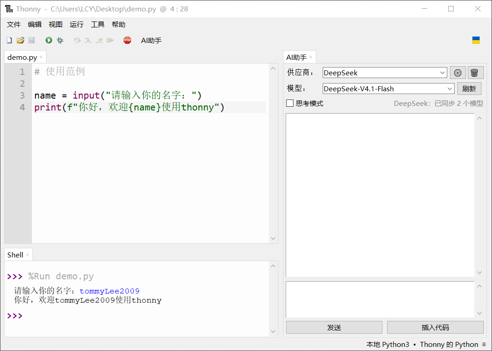

# Thonny AI Assistant

[简体中文](#简体中文) |  [English](#English) 



# 简体中文

这是一个为 Thonny Python IDE 提供双语界面的 AI 助手插件，支持侧边栏聊天、代码分析、流式回复、多供应商配置、模型参数调整和全局系统提示词。

## 项目来源

本项目基于
[Oliver0804/thonny_openai_gpt](https://github.com/Oliver0804/thonny_openai_gpt)
修改而来。上游项目在 README 和包元数据中声明使用 MIT 许可证，但当前没有单独
的 LICENSE 文件。本仓库补齐了完整 MIT 许可文本，并保留了原作者版权声明，
见 [LICENSE](LICENSE)。

本仓库的主要修改包括多供应商配置、模型列表同步、流式输出、Thonny 明暗主题
适配、自定义系统提示词和中英文界面。

**原项目作者：** Oliver0804  
**原项目邮箱：** [icetzsr@gmail.com](mailto:icetzsr@gmail.com)

**软件作者及维护者：** TommyLee2009  
**邮箱：** [lcy28898830@gmail.com](mailto:lcy28898830@gmail.com)

本项目与 Thonny、OpenAI、DeepSeek 和阿里云均无隶属或官方背书关系。

## 功能

- 在 Thonny 侧边栏中与 AI 对话。
- 分别配置多个 OpenAI 兼容模型供应商。
- 通过供应商的 `/models` 接口获取模型。
- 切换供应商和模型。
- 在设置窗口中调整温度和输出 tokens 上限。
- 在主面板的模型状态信息旁开关思考模式。
- 流式显示回复，网络请求不会阻塞 Tk 主线程。
- 分析当前选中的代码或完整文件。
- 设置全局系统提示词，用于限定角色、回答结构和质量要求。
- 自动附加 Thonny 当前编译器/解释器环境信息。
- 跟随 Thonny 明暗主题。
- 保存本地聊天记录。
- 根据 Thonny 界面语言自动使用中文或英文。

## 语言切换

插件读取 Thonny 的 `general.language` 设置：

- `zh_CN`、`zh_TW`、`zh_Hans` 以及其他 `zh_*` 语言显示中文。
- 其他界面语言统一显示英文。

Thonny 修改界面语言后需要重启。重启 Thonny 后，插件工具栏、页签、菜单、
设置窗口、状态提示和错误信息会一并切换。

## 安装

1. 确认 **Thonny 版本为 5.0.0 或更高版本**。低于 5.0.0 时，插件安装的用户
   目录可能与 Thonny 实际加载目录不一致，导致插件无法正常加载或运行。
2. 打开 Thonny 的“工具 > 管理插件”。
3. 切换到“从PyPI安装”，搜索并安装 `thonny-ai-assistant`。
4. 离线安装时，先下载对应的 `.whl` 文件，再在“管理插件”中选择从本地安装
   该 wheel 文件。
5. 安装完成后重启 Thonny。

如果插件刚完成首次 PyPI 发布但尚未出现在搜索结果中，请使用离线 wheel
安装方式。不要只把 wheel 放到 Thonny 目录中，必须通过“管理插件”安装，
以正确注册 Python 包和 Thonny 插件入口。

安装包入口为 `thonny-ai-assistant`，内部视图 ID 保持为 `AIChatView`。

PyPI 发布使用 GitHub Actions OIDC，配置和发布步骤见
[PUBLISHING.md](PUBLISHING.md)。

## 配置供应商

1. 打开 Thonny 的“视图 > AI助手”。
2. 点击设置按钮。
3. 填写供应商名称、API 地址和 API Key。
4. 在“生成参数”中调整温度和输出 tokens 上限。
5. 根据需要填写全局系统提示词。
6. 点击“保存并获取模型”。
7. 在顶部选择供应商和模型。

模型供应商需要兼容以下接口：

```text
GET  {API 地址}/models
POST {API 地址}/chat/completions
```

## 数据与隐私

本地配置和聊天记录保存在：

```text
~/.thonny/thonny_ai_assistant_config/config.json
```

API Key 以明文保存在本机配置文件中。不要将该文件上传到 GitHub、发送给他人
或截图公开。Key 一旦泄露，应立即到供应商平台撤销并重新创建。

代码和提示词会发送到用户选择的模型供应商。涉及个人信息时，应先脱敏并确认数据使用范围。

## 开发与验证

运行本地语言测试：

```powershell
& "C:\Program Files\Thonny\python.exe" -m unittest discover -s tests -v
```

构建 wheel：

```powershell
& "C:\Program Files\Thonny\python.exe" -m pip wheel . --no-deps --wheel-dir dist
```

## 许可证

本项目采用 [MIT License](LICENSE)。

Copyright (c) 2025 Oliver0804  
Copyright (c) 2026 TommyLee2009

----
# English
A bilingual AI assistant plugin for the Thonny Python IDE. It provides a
side-panel chat, code analysis, streaming responses, multiple
OpenAI-compatible providers, configurable generation parameters, and a global
system prompt.

## Attribution

This project is based on and substantially modified from
[Oliver0804/thonny_openai_gpt](https://github.com/Oliver0804/thonny_openai_gpt).
The upstream project declares the MIT License in its README and package
metadata, but does not currently provide a standalone license file. This
repository includes the complete MIT text and preserves the original copyright
notice in [LICENSE](LICENSE).

Major modifications in this repository include multi-provider configuration,
automatic model discovery, streaming output, theme integration, configurable
system prompts, and Chinese/English localization.

**Original project author:** Oliver0804  
**Original project contact:** [icetzsr@gmail.com](mailto:icetzsr@gmail.com)

**Maintainer and software author:** TommyLee2009  
**Email:** [lcy28898830@gmail.com](mailto:lcy28898830@gmail.com)

This project is not affiliated with or endorsed by the Thonny project, OpenAI,
DeepSeek, or Alibaba Cloud.

## Features

- Chat with AI from a Thonny side panel.
- Configure multiple OpenAI-compatible providers independently.
- Discover available models through the provider's `/models` endpoint.
- Select the provider and model from the panel.
- Configure temperature and output token limit in the settings dialog.
- Toggle thinking mode beside the model status in the main panel.
- Stream responses without blocking the Tk main thread.
- Analyze selected code or the complete file in the current editor.
- Configure a global system prompt for role and quality requirements.
- Automatically include Thonny's current interpreter environment context.
- Follow Thonny's light and dark UI themes.
- Save local chat history.
- Use Chinese or English automatically based on Thonny's UI language.

## Language behavior

The plugin reads Thonny's `general.language` option:

- `zh_CN`, `zh_TW`, `zh_Hans`, or any other `zh_*` language uses Chinese.
- Every other Thonny language falls back to English.

Thonny requires a restart after changing its interface language. Restart
Thonny for the plugin labels and dialogs to switch languages too.

## Requirements

- Thonny 5.0.0 or newer. Older versions may use a different user plugin
  directory from the one Thonny actually loads, causing the plugin to
  malfunction.
- `openai>=1.75.0`.
- Network access to the configured model provider.
- A valid API key for that provider.

## Installation

1. Confirm that **Thonny 5.0.0 or newer** is installed. Older versions may use
   a different user plugin directory from the one Thonny actually loads.
2. Open **Tools > Manage plugins** in Thonny.
3. Open **Install from PyPI** and search for `thonny-ai-assistant`.
4. For offline installation, download the required `.whl` file and install it
   from the local-file option in **Manage plugins**.
5. Restart Thonny after installation.

If the package has just been published to PyPI and does not appear in search
results yet, use the offline wheel option. Copying a wheel into the Thonny
directory is not sufficient; install it through **Manage plugins** so the
Python package and Thonny entry point are registered correctly.

The package entry point is `thonny-ai-assistant`. The internal Thonny view
identifier remains `AIChatView`.

PyPI publication uses GitHub Actions OIDC. See
[PUBLISHING.md](PUBLISHING.md) for trusted-publisher settings and the release
procedure.

## Configuration

1. Open **View > AI Assistant** (or **视图 > AI助手**).
2. Click the gear button.
3. Enter the provider name, API base URL, and API key.
4. Adjust temperature and output tokens in **Generation settings**.
5. Optionally define a global system prompt.
6. Click **Save and fetch models** (or **保存并获取模型**).
7. Select the provider and model in the panel.

The provider must implement:

```text
GET  {API base URL}/models
POST {API base URL}/chat/completions
```

## Configuration and privacy

Local configuration and chat history are stored in:

```text
~/.thonny/thonny_ai_assistant_config/config.json
```

API keys are stored locally in plain text. Do not publish this file, commit it
to GitHub, or include it in screenshots. Revoke a key immediately if it is
exposed. Code and prompts are sent to the provider selected by the user.
Remove student names, student IDs, grades, employer information, and other
sensitive data before sending content to an external model.

See [SECURITY.md](SECURITY.md) for vulnerability reporting.

## License

This project is distributed under the [MIT License](LICENSE).

Copyright (c) 2025 Oliver0804  
Copyright (c) 2026 TommyLee2009

The MIT terms require retaining the copyright and permission notice in copies
or substantial portions of the software.

---
